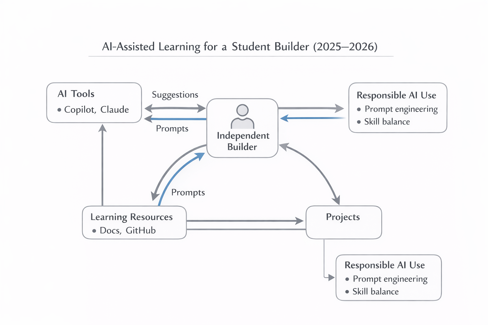
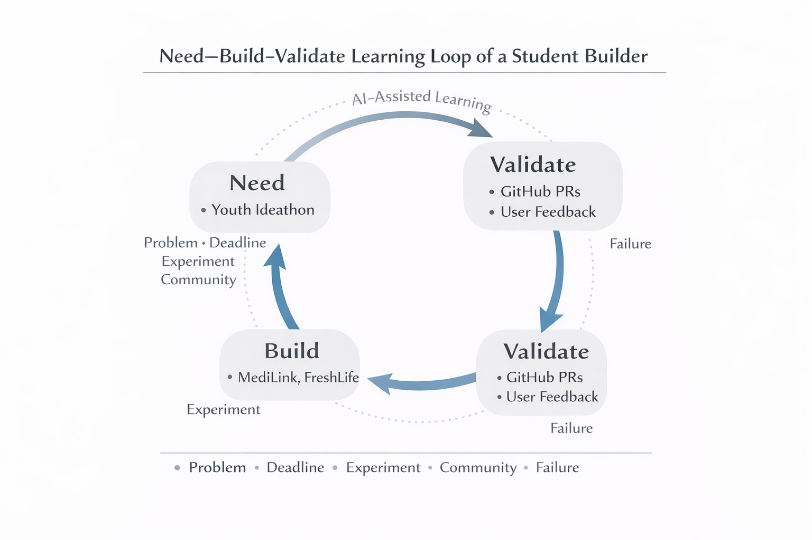
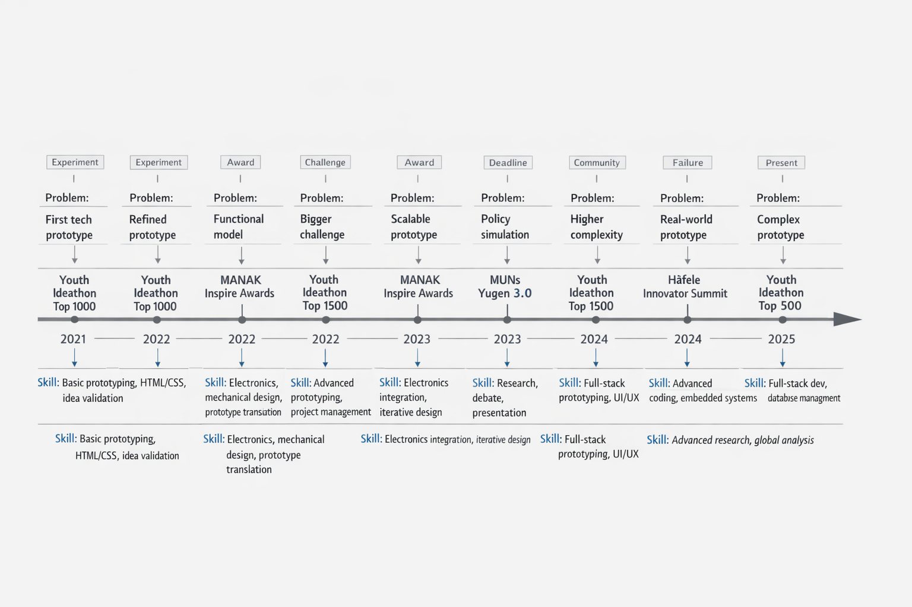
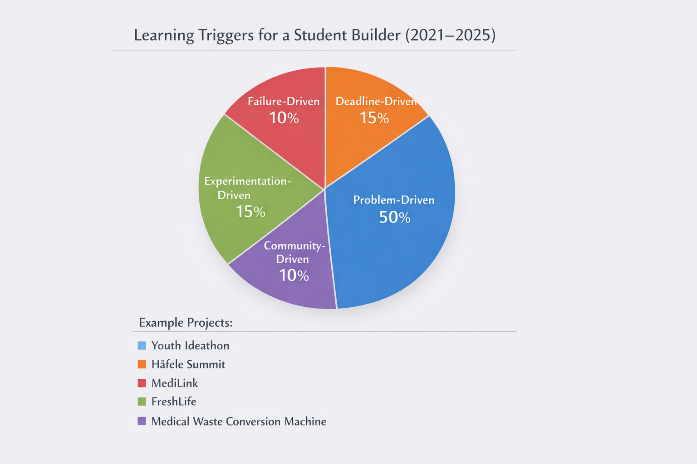
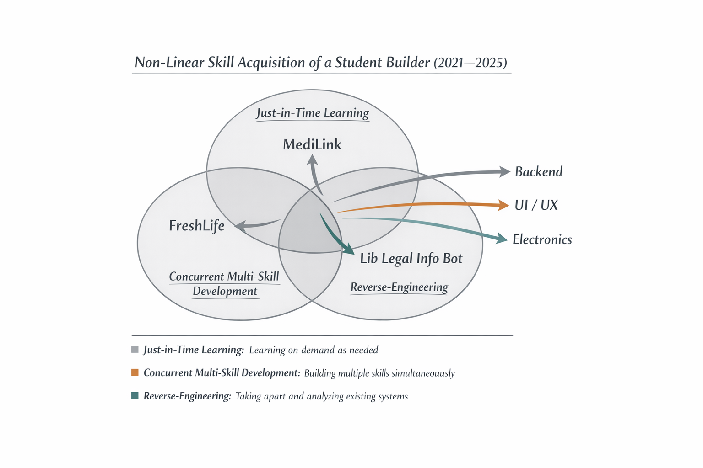
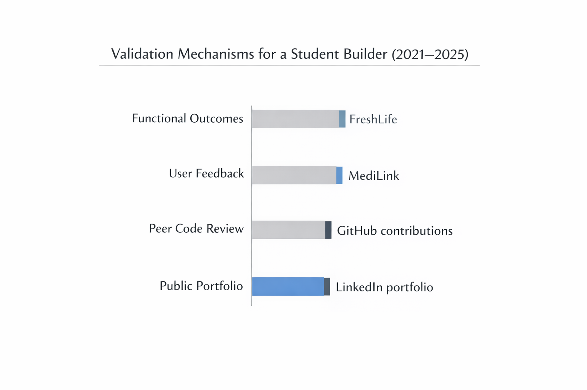

# Learning Without Curriculum: Autonomous Project-Based Skill Acquisition and the Scaffolding Dynamics of Generative AI

**Author:** Ruthwik Reddy  
**Affiliation:** Independent Student Researcher  
**Year:** 2026  
**Document Format:** Academic Research Paper ([paper.pdf](paper.pdf) | [paper.tex](paper.tex) | [references.bib](references.bib))

---

## Abstract

Most formal education follows a set curriculum: an instructor plans the syllabus, paces each topic, and tests students with periodic exams. Outside the classroom, however, many people learn complex technical skills in a completely different way---by jumping straight into real projects and figuring things out as problems arise. With the rise of modern generative AI, this kind of self-directed learning has become much more practical. Coding assistants and large language models can act as on-demand tutors, answering questions, fixing errors, and helping learners break through roadblocks that once would have stopped them in their tracks.

Yet this convenience creates an important puzzle: when an AI can write code and explain concepts in seconds, it is tempting to skip the mental struggle that real learning requires. This can lead to an **"illusion of competence"**, where learners confuse what the AI can do with what they actually understand themselves.

In this paper, we look closely at how self-directed, project-based learning works alongside modern AI. We trace the history of independent learning from Piaget, Papert, and Bruner, and describe the four main roles AI plays for students: *Tool*, *Mediator*, *Teammate*, and *Subject Matter Expert*. Reviewing recent classroom studies, we highlight quantitative evidence showing how simple reflection habits double student self-monitoring ($F = 31.91, p < 0.001$) and cut down mindless copy-pasting. We also examine the **ACCEL framework**, explain why student evaluation must track the learning process rather than just the final code, and compare project-based learning with traditional courses on outcomes, scale, and equity. Finally, we share practical takeaways for students, teachers, tool designers, and universities.

---

## 1. Guiding Research Questions

This study focuses on two central questions:

1. **How do self-directed learners pick up, organize, and test complex technical skills without a traditional curriculum?**
2. **When does generative AI genuinely help people learn, and when does it become a crutch that replaces real understanding?**

---

## 2. Theoretical Foundations: From Constructionism to Conversational AI

The idea that people can learn deeply without a pre-set curriculum has a rich history in cognitive science and education:

* **Jean Piaget (Constructivism)**: Observed that young children learn complex abilities---like language and spatial navigation---through spontaneous interaction and play long before entering formal classrooms.
* **Seymour Papert (*Mindstorms*, 1980)**: Called Piaget the original theorist of "learning without curriculum." Papert showed that traditional classrooms were an artificial compromise born from a lack of responsive tools. He created computational micro-worlds (LOGO) with a **"low threshold and no ceiling"** so learners have concrete "objects to think with."
* **Jerome Bruner (Instructional Scaffolding, 1976)**: Showed that when beginners tackle difficult problems, an effective tutor or tool temporarily takes care of parts they cannot handle alone, keeping them focused within their Zone of Proximal Development (ZPD).
* **Self-Regulated Learning (SRL)** (Zimmerman, 2002): Explains how learners manage their own work: setting clear goals, tracking their own progress, and reflecting honestly when things fail.
* **Situated Cognition** (Lave & Wenger, 1991): Reminds us that knowing and doing cannot be separated. Students understand abstract concepts much faster when they encounter them while solving real problems in developer communities and open-source projects.



### The Shift to Conversational Learning

Traditional education treats instruction as a one-way street: the instructor lectures, and students submit static assignments. Working with modern AI is an interactive, live conversation:

$$	ext{Learner Goal} \longrightarrow 	ext{AI Suggestion/Draft} \longrightarrow 	ext{Human Testing \& Critique} \longrightarrow 	ext{Refined Code}$$

Instead of passively following a textbook, the student becomes the active manager of their own learning.



---

## 3. Empirical Evidence for Project-Based Learning

The argument for learning by building is backed by decades of classroom and field research.

### 3a. Meta-Analytic Evidence (66 Studies)

A 2023 meta-analysis covering **66 K–12 STEM studies** (Zheng et al., *Educational Research Review*, 2023) compared project-based learning to conventional instruction:

| Learning Outcome | Effect Size (SMD) | Practical Takeaway |
| :--- | :---: | :--- |
| **Overall Learning Achievement** | **0.44\*** | Consistent advantage for project-based learners |
| **Creative Thinking** | **0.72\*** | Major boost in generating original solutions |
| **Computational Thinking** | **0.63\*** | Strong gains in algorithmic problem solving |
| **Problem Solving & Collaboration** | **0.58\*** | Significant improvement in teamwork and troubleshooting |
| **Student Interest & Motivation** | **0.71\*** | Sizable jump in student engagement and persistence |

*\* Statistically significant ($p < 0.001$)*



### 3b. Cultural Differences in Self-Directed Learning

* **Guglielmino (2011)** — Survey across 17 countries: readiness for self-directed learning varies widely across different cultural and educational systems.
* **Frambach et al. (2012)** — Medical education study: students raised in strictly exam-focused or hierarchical schools often struggle with open-ended freedom and need explicit coaching in goal setting.
* **Key Takeaway**: Self-direction is a learnable skill that must be explicitly taught, not an automatic trait that every student already has.

### 3c. Case Study: Edinburgh's SLICC Program

The University of Edinburgh's **Student-Led, Individually-Created Courses (SLICC)** initiative (Spiers et al., 2020) lets undergraduates propose their own projects (such as research, internships, or community work), set their own goals, and build reflective e-portfolios:
* Participants became significantly better at articulating what they learned and connecting project experience to future jobs.
* Mistakes were treated as useful evidence of growth rather than failures.
* The program deliberately supported students from non-traditional and widening-participation backgrounds, showing that structured independence expands opportunity.



---

## 4. The Four Roles of AI in Self-Directed Projects

When learners tackle real projects, they naturally integrate generative AI into four distinct roles (Zheng et al., CHI 2024):

| Perceived Role | What the Learner Does | Impact on Learning |
| :--- | :--- | :--- |
| **Tool / Assistant** | Delegates routine chores: writing boilerplate, fixing typos, formatting data. | Lowers startup friction. *Risk*: Can lead to mindless copy-pasting if code is never examined. |
| **Mediator** | Translates ideas across tools, clarifies cryptic terminal errors, turns vague thoughts into specs. | Makes cross-disciplinary learning smoother; connects new ideas to existing knowledge. |
| **Equal Teammate** | Bounces design ideas back and forth, explores tradeoffs, checks edge cases. | Encourages active discussion; pushes learners to rethink assumptions when the AI suggests alternatives. |
| **Subject Matter Expert** | Asks conceptual questions on demand about algorithms, system design, or security. | Gives fast, personalized answers. *Risk*: Learners can blindly accept plausible-sounding hallucinations. |



---

## 5. The Cognitive Offloading Dilemma: Support vs. Crutch

Under **Cognitive Load Theory** (Sweller, 1988), our working memory can only handle a few things at once. Handing off tedious tasks to a computer frees up mental bandwidth for high-level problem solving.

However, real learning requires **effortful mental struggle**: wrestling with logic, making mistakes, and figuring out why something broke (Ericsson et al., 1993). When learners offload that struggle completely to an AI, they skip the friction that builds lasting knowledge. This creates an **"illusion of competence"** (Song et al., 2026): watching an AI generate code feels effortless, so students assume they understand it---until they have to write it from scratch on an empty screen.

### Empirical Evidence: Structured Reflection vs. Unguided AI Use

A controlled study by **Song, Alias, & Jamaludin (2026)** (*Frontiers in Education*, DOI: [10.3389/feduc.2026.1760298](https://doi.org/10.3389/feduc.2026.1760298)) tracked students completing intensive data science projects. One group followed a structured reflection routine (logging prompts, reviewing outputs, questioning assumptions), while the control group used AI freely:

| Skill or Behavior | With Structured Reflection | Without Structure (Free AI Use) | What This Means in Plain English |
| :--- | :--- | :--- | :--- |
| **Active Self-Monitoring** | Jumped from 3.55 to **4.32 / 5.0 (+22%)** ($F = 31.91, p < 0.001$). | Stagnant; stayed flat at **3.60 / 5.0**. | Keeping a simple prompt log trains students to catch their own mistakes early. |
| **Deep Understanding** | Statistically significant improvement in core concept mastery. | No meaningful change from starting baseline. | Reflecting on AI answers helps students truly understand the underlying principles. |
| **Mindless Copy-Pasting** | Sharp, noticeable drop in surface-level shortcuts. | Persistent reliance on quick copy-paste habits. | Without guidance, most students just copy code without reading or understanding it. |
| **Checking Code for Flaws** | **87% of students (13/15)** actively tested and audited code. | **Only 13% of students (2/15)** examined code before using it. | Students rarely check AI code for bugs unless prompted to do so. |
| **Questioning Assumptions** | **80% of students (12/15)** re-evaluated their initial plans. | **Only 7% of students (1/15)** questioned their original premises. | Stepping back to ask "is this even the right approach?" had the strongest link to true independence ($r = 0.76$). |



---

## 6. Comparing Traditional Curricula and Project-Based Learning

| Dimension | Traditional Curriculum | Independent Project-Based Learning |
| :--- | :--- | :--- |
| **Learning Outcomes** | Broad, even coverage of standard textbook topics; easy to test with exams; strong short-term recall. | Deeper conceptual understanding, stronger retention over time, and better real-world problem solving (Barron et al., 1998; Kumar et al., 2024). |
| **Scalability & Access** | Scales through physical institutions (schools, faculty, textbooks); structured but expensive and location-bound. | Scales through digital networks (open-source software, online forums, AI tutors); on-demand help available 24/7. |
| **Equity & Support** | Gives all students the same baseline instruction, helping those who struggle with self-direction. | Highly empowering for motivated self-starters; however, differences in computer access and self-direction skills can leave some students behind without explicit mentoring (Ravi et al., 2025; Spiers et al., 2020). |

---

## 7. The ACCEL Framework for Engineering with AI

When AI can write boilerplate in seconds, what does technical expertise actually look like? The **ACCEL Framework** (*Agentic Competencies through Curricula, Collaboration, and Enduring Learning*) (Alenezi, 2026) highlights five core pillars:

1. **P1: Intent Framing**: Breaking down big, messy problems into clear requirements, inputs, outputs, and edge cases before prompting.
2. **P2: Iterative Verification**: Carefully reading generated code, writing unit tests, and catching subtle logic bugs or security holes.
3. **P3: Workflow Orchestration**: Connecting code, APIs, build scripts, and automated test suites into a reliable working system.
4. **P4: Reliance Calibration**: Knowing when to lean on AI (routine boilerplate) and when human judgment must take over (core business logic and security).
5. **P5: Ethics & Accountability**: Taking personal responsibility for software safety, user privacy, copyright licenses, and real-world impact.

### A Four-Stage Learning Path
* **Stage 1 (Foundations)**: AI acts as a friendly tutor; code generation is kept minimal so learners build their own mental models.
* **Stage 2 (Guided Collaboration)**: AI acts like a pair programmer; focus shifts to writing clear prompts, reviewing code, and spotting bugs.
* **Stage 3 (Supervised Delegation)**: The learner directs AI agents on multi-step tasks (like writing tests or refactoring) and checks the output against strict acceptance criteria.
* **Stage 4 (System Architecture)**: The learner designs and oversees full projects, orchestrating multiple tools while maintaining total responsibility for the final system.

---

## 8. Rethinking Assessment: Grade the Process, Not Just the Code

Because an AI can generate a working web app from a prompt, grading solely on the final code artifact no longer works. 

**Process-Trace Evaluation** looks at the student's problem-solving journey:
1. **Prompt Logs**: Reviewing the questions and iterations between the student and the AI to see how the student framed the problem.
2. **Git Commit History**: Inspecting diffs to see where the student modified, improved, or threw away AI suggestions.
3. **Decision Notes**: Brief notes explaining why specific libraries, databases, or architectures were chosen over alternatives.
4. **Bug-Hunting Checks**: Quick exercises testing whether the student can spot and fix intentional bugs in AI-generated code.
5. **Live Walkthroughs**: Short conversations where the student explains how their system works and fixes a small bug on the spot without AI assistance.

---

## 9. Practical Recommendations

* **For Learners**: Treat AI as a thinking partner, not a vending machine for answers. Always think through how you would solve a problem before asking an AI, test generated code thoroughly, and keep a log of mistakes.
* **For Teachers**: Shift away from grading memorized syntax. Focus on problem framing, code reviews, and system design. Teach students explicitly how to audit AI outputs.
* **For Tool Designers**: Build tools that encourage real learning rather than just raw speed. Add prompts that ask users to explain their intent, highlight uncertain code, and suggest helpful debugging questions.
* **For Schools & Universities**: Expand credit for prior learning and digital project portfolios so self-taught builders can turn real-world projects into recognized academic credentials.

---

## 10. Repository Structure & Local Build

```
learning-without-curriculum/
├── README.md              # Project documentation and summary
├── paper.tex              # Clean LaTeX paper source code (16 pages)
├── paper.pdf              # Compiled, publication-ready research paper
├── references.bib         # Verified academic bibliography
└── assets/                # Visual charts and conceptual diagrams
    ├── timeline.png
    ├── loop.png
    ├── schematic.png
    ├── piechart.png
    ├── venn.png
    └── horizontalbar.png
```

### Compiling the Research Paper Locally

To build `paper.pdf` from source:
```bash
pdflatex -interaction=nonstopmode paper.tex
bibtex paper
pdflatex -interaction=nonstopmode paper.tex
pdflatex -interaction=nonstopmode paper.tex
```

---

## 11. Selected References

* **Alenezi, M. (2026)**. Educating the agentic engineer: Curricula, collaboration, and continuous learning in the AI era. *arXiv preprint arXiv:2607.29610*.
* **Barron, B. J. S., et al. (1998)**. Doing with understanding: Lessons from research on problem- and project-based learning. *Journal of the Learning Sciences*, 7(3-4), 271–311.
* **Blumenfeld, P. C., et al. (1991)**. Motivating project-based learning: Sustaining the doing, supporting the learning. *Educational Psychologist*, 26(3-4), 369–398.
* **Chen, E., et al. (2026)**. When AI agents learn from each other: Insights from emergent AI agent communities on OpenClaw for human-AI partnership in education. *arXiv preprint arXiv:2603.16663*.
* **Ericsson, K. A., Krampe, R. T., & Tesch-Römer, C. (1993)**. The role of deliberate practice in the acquisition of expert performance. *Psychological Review*, 100(3), 363–406.
* **Frambach, J. M., et al. (2012)**. Rethinking the globalisation of problem-based learning: How culture challenges self-directed learning. *Medical Education*, 46(8), 738–750.
* **Guglielmino, L. M. (2011)**. Self-directed learning readiness and culture: A cross-national investigation across seventeen societies. *International Journal of Self-Directed Learning*, 8(2), 1–18.
* **Kumar, H., et al. (2024)**. Supporting self-reflection at scale with large language models: Insights from randomized field experiments in classrooms. *Proceedings of the Eleventh ACM Conference on Learning @ Scale (L@S '24)*. DOI: 10.1145/3657604.3662042.
* **Lave, J., & Wenger, E. (1991)**. *Situated Learning: Legitimate Peripheral Participation*. Cambridge University Press.
* **Papert, S. (1980)**. *Mindstorms: Children, Computers, and Powerful Ideas*. Basic Books.
* **Ravi, P., et al. (2025)**. Co-designing large language model tools for project-based learning with K12 educators. *Proceedings of the 2025 ACM CHI Conference on Human Factors in Computing Systems (CHI '25)*. DOI: 10.1145/3706598.3713971.
* **Song, R., Alias, A., & Jamaludin, K. A. B. (2026)**. Heutagogy and generative AI: An empirical investigation of self-determined learning on deep learning outcomes. *Frontiers in Education*, 11, 1760298.
* **Spiers, A., et al. (2020)**. Student-Led, Individually-Created Courses (SLICCs): Enabling autonomous experiential learning and metacognitive reflection in higher education. *Journal of Perspectives in Applied Academic Practice*, 8(1), 44–56.
* **Sweller, J. (1988)**. Cognitive load during problem solving: Effects on learning. *Cognitive Science*, 12(2), 257–285.
* **Thomas, J. W. (2000)**. *A Review of Research on Project-Based Learning*. The Autodesk Foundation.
* **VanLehn, K., et al. (2005)**. The relative effectiveness of human tutoring, intelligent tutoring systems, and other tutoring systems. *Educational Psychologist*, 40(1), 3–29.
* **Wood, D., Bruner, J. S., & Ross, G. (1976)**. The role of tutoring in problem solving. *Journal of Child Psychology and Psychiatry*, 17(2), 89–100.
* **Zheng, C., et al. (2024)**. Charting the future of AI in project-based learning: A co-design exploration with students. *Proceedings of the 2024 ACM CHI Conference on Human Factors in Computing Systems (CHI '24)*. DOI: 10.1145/3613904.3642807.
* **Zheng, L., et al. (2023)**. Effects of project-based learning on student learning outcomes in STEM: A meta-analysis of 66 studies. *Educational Research Review*, 41, 100561.
* **Zimmerman, B. J. (2002)**. Becoming a self-regulated learner: An overview. *Theory Into Practice*, 41(2), 64–70.

---
*Authored by Ruthwik Reddy (2026).*
